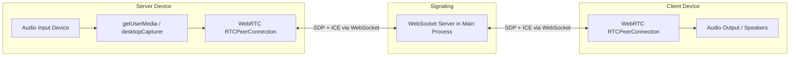

# AudioLink — Low-Latency LAN Audio Streamer

A Windows Electron application that streams audio from one device (server) to another (client) over the local network with minimum latency. No admin permissions required.

## Architecture Overview



### Key Design Decisions

| Decision | Choice | Rationale |
|---|---|---|
| **Transport** | WebRTC (peer-to-peer) | Built-in to Chromium/Electron, UDP-based, designed for ultra-low-latency media |
| **Codec** | Opus (WebRTC default) | Excellent low-latency audio codec, tunable down to ~10ms frames |
| **Signaling** | WebSocket (`ws` library) | Lightweight; runs inside Electron's main process on the server |
| **Discovery** | Manual IP entry + auto-display of server IP | Simple, reliable, no mDNS complexity |
| **Audio Capture** | `getUserMedia` for input devices, `desktopCapturer` loopback for system audio | Covers both microphones and system/app audio |
| **Scaffolding** | Electron Forge + Vite | Official tooling, fast builds, modern DX |
| **Security** | Preload + contextBridge | No `nodeIntegration`, follows Electron security best practices |

## User Review Required

> [!IMPORTANT]
> **Audio Device Types**: The app will support two audio source types:
> 1. **Input devices** (microphones, line-in, virtual cables) — via `getUserMedia`
> 2. **System audio loopback** (what you hear) — via `desktopCapturer` with `audio: 'loopback'`
>
> The user selects from a dropdown on the server UI. Does this cover your use case, or do you specifically need to capture audio from individual output devices (e.g., only from a specific application)?

> [!IMPORTANT]  
> **Single client or multiple clients?** The current plan supports **one client at a time** connecting to the server. Should we support multiple simultaneous clients receiving the same audio stream?

> [!NOTE]
> **No admin permissions**: The entire stack (Electron, WebRTC, WebSocket on high port) runs in user space. No elevated privileges are needed.

## Proposed Changes

### Project Setup

#### [NEW] Electron Forge project scaffolding

```
c:\D\My\audiolink\
├── package.json
├── forge.config.js
├── vite.main.config.mjs
├── vite.preload.config.mjs
├── vite.renderer.config.mjs
└── src/
    ├── main/           # Main process
    │   └── main.js
    ├── preload/        # Preload scripts
    │   └── preload.js
    └── renderer/       # UI (HTML/CSS/JS)
        ├── index.html
        ├── index.css
        ├── app.js
        ├── server.js   # Server-mode UI logic
        └── client.js   # Client-mode UI logic
```

---

### Main Process — `src/main/main.js`

Responsibilities:
- Create the BrowserWindow
- Run the **WebSocket signaling server** (port `8765`) when in server mode
- Handle `desktopCapturer` for system audio loopback
- Expose APIs to the renderer via IPC:
  - `get-local-ip` — returns the machine's LAN IP address
  - `start-signaling-server` — starts the WebSocket server
  - `stop-signaling-server` — stops the WebSocket server
  - `setup-loopback-audio` — configures `setDisplayMediaRequestHandler` for loopback capture

---

### Preload Script — `src/preload/preload.js`

Exposes a safe `window.electronAPI` bridge:
```js
window.electronAPI = {
  getLocalIP: () => ipcRenderer.invoke('get-local-ip'),
  startSignalingServer: () => ipcRenderer.invoke('start-signaling-server'),
  stopSignalingServer: () => ipcRenderer.invoke('stop-signaling-server'),
  setupLoopbackAudio: () => ipcRenderer.invoke('setup-loopback-audio'),
  onSignalingMessage: (callback) => ipcRenderer.on('signaling-message', callback),
  sendSignalingMessage: (msg) => ipcRenderer.send('signaling-message-send', msg),
}
```

---

### Renderer — UI & WebRTC Logic

#### [NEW] `src/renderer/index.html` + `src/renderer/index.css`
- **Mode selection screen**: "Start as Server" / "Connect as Client" with a premium dark-mode UI
- **Server view**:
  - Audio device dropdown (input devices + "System Audio" option)
  - Server IP + port displayed prominently
  - Status indicator (waiting / connected / streaming)
  - Audio level meter (visual feedback)
  - Stop button
- **Client view**:
  - Server IP input field
  - Connect button
  - Status indicator
  - Volume control
  - Audio level meter

**Design**: Dark glassmorphism theme, smooth transitions, Inter font, vibrant accent colors (teal/cyan gradient), micro-animations.

#### [NEW] `src/renderer/app.js`
- Mode selection logic, view switching

#### [NEW] `src/renderer/server.js`
Server-mode logic:
1. Enumerate audio devices via `navigator.mediaDevices.enumerateDevices()`
2. Capture selected device via `getUserMedia({ audio: { deviceId: { exact: id } } })` or `getDisplayMedia()` for system audio
3. Apply low-latency constraints: `echoCancellation: false`, `noiseSuppression: false`, `autoGainControl: false`, `latency: 0`
4. Create `RTCPeerConnection` (no STUN needed for LAN, but include Google STUN as fallback)
5. Add audio track to peer connection
6. Modify SDP to set `minptime=10` for minimum Opus frame size
7. Exchange SDP/ICE via the WebSocket signaling channel

#### [NEW] `src/renderer/client.js`
Client-mode logic:
1. Connect to server's WebSocket signaling endpoint
2. Create `RTCPeerConnection`
3. On receiving remote track, pipe to `<audio>` element with `autoplay`
4. Exchange SDP/ICE via WebSocket

---

### Signaling Server — integrated in Main Process

The WebSocket signaling server is minimal:
- Runs on port `8765` (user-space, no admin needed)
- Relays SDP offers/answers and ICE candidates between server renderer and connected client
- Handles exactly one client connection at a time (or multiple if requested)

## Latency Optimization Summary

| Layer | Optimization |
|---|---|
| **Capture** | Disable echo cancellation, noise suppression, AGC; set `latency: 0` |
| **Codec** | Opus with `minptime=10` (~10ms frames) |
| **Transport** | WebRTC over UDP, direct peer-to-peer on LAN |
| **Network** | No TURN relay needed on LAN; host ICE candidates only |
| **Playback** | Direct `<audio>` element playback, browser manages jitter buffer |

Expected end-to-end latency on LAN: **~20-50ms** (capture + encode + network + decode + playback).

## Open Questions

> [!IMPORTANT]
> 1. **Single or multi-client?** Should multiple devices be able to listen simultaneously, or is 1-to-1 sufficient?
> 2. **Audio source scope**: Do you need to capture audio from specific individual apps, or is "all system audio" + "specific input devices" sufficient?
> 3. **Auto-discovery**: Would you like devices to auto-discover each other on the network (via UDP broadcast), or is manually entering the server IP acceptable?

## Verification Plan

### Automated Tests
- Start the app, verify WebSocket server starts successfully on the configured port
- Verify audio device enumeration returns devices
- Verify the app launches without admin permissions

### Manual Verification
- Run two instances on separate machines on the same LAN
- Server selects a microphone and starts streaming
- Client enters server IP and connects
- Verify audio plays on client with low perceived latency
- Test system audio loopback capture
- Test reconnection after disconnect
